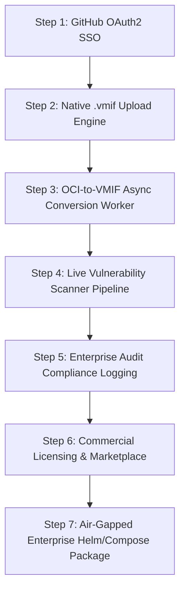

# Vyoma Hub — Full Architecture & Roadmap Implementation Tracker

This document provides continuous, real-time tracking of all subsystems and deliverables outlined in [`docs/system-architecture.md`](file:///home/subesh/Startup_Projects/Vyoma/Vyoma-Hub/docs/system-architecture.md) for **Vyoma Hub** (`hub.vyoma.dev`).

---

## Master Progress Dashboard

| Phase | Subsystem / Capability | Status | Implementation Target | Verification Gates |
|---|---|:---:|---|---|
| **Phase 1** | **OCI v2 Distribution API** | ✅ **COMPLETE** | `/v2/`, manifests, chunked blob streaming | Unit tests + MinIO S3 integration |
| **Phase 1** | **User Auth & PAT Tokens** | ✅ **COMPLETE** | Argon2id, JWT, scoped PATs (`/v2/token`) | Passwords, PAT hashing, JWT verify tests |
| **Phase 1** | **GitHub OAuth2 Authentication** | ✅ **COMPLETE** | `/api/v1/auth/oauth/github/*` | GitHub exchange + JWT generation (Merged `bb1fe12`) |
| **Phase 2** | **Certified Kernel Catalog** | ✅ **COMPLETE** | `/api/v1/kernels`, Ed25519 signatures | Seeded 5 profiles, signature verification |
| **Phase 2** | **Hub UI Explorer & Sliders** | ✅ **COMPLETE** | Next.js 16, interactive CLI generator | `next build` 319ms, live on `:3000` |
| **Phase 2** | **Native `.vmif` Upload Engine** | ✅ **COMPLETE** | `POST /api/v1/appliances/upload`, manifest routes | Tested & Merged (`5844fee`) |
| **Phase 2** | **OCI $\rightarrow$ VMIF Conversion Worker**| ✅ **COMPLETE** | Async worker converting OCI layers to Squashfs | Tested & Merged (`6c3b617`) |
| **Phase 3** | **Notary Cryptographic Gatekeeper** | ✅ **COMPLETE** | `transparency_logs`, Ed25519 countersign | Merkle tree pairwise root tests |
| **Phase 3** | **Automated CVE Scanner Pipeline** | ✅ **COMPLETE** | Real-time layer package scanner | Tested & Merged (`66ad17d`) |
| **Phase 3** | **Publisher Badges & Key Tracking** | ✅ **COMPLETE** | Verified organization badges, public keys | Database relations + seeder |
| **Phase 4** | **Multi-Tenant Team RBAC** | ✅ **COMPLETE** | `org_members`, role tiers (owner/admin/member) | RBAC tests + UI Management Tab |
| **Phase 4** | **Signed Webhook Dispatcher** | ✅ **COMPLETE** | HMAC-SHA256 (`X-Vyoma-Signature-256`) | Test ping dispatch + delivery audit log |
| **Phase 4** | **Enterprise Audit Compliance Logging** | ✅ **COMPLETE** | Immutable `audit_logs` table & API | Verified & Merged (`6c3b617`) |
| **Phase 4** | **Commercial Licensing & Marketplace** | ✅ **COMPLETE** | Ed25519 license tokens, entitlement verification | Verified & Merged (`6c3b617`) |
| **Phase 4** | **Enterprise Self-Hosting Assets** | ✅ **COMPLETE** | Air-gapped Helm chart & Compose bundle | Tested & Merged (`66ad17d`) |

---

## Detailed Deliverable Breakdown

### Phase 1: MVP Registry & Auth
- [x] OCI Distribution Spec v2 Handshake (`GET /v2/`)
- [x] Docker CLI Token Negotiation (`GET /v2/token`)
- [x] Monolithic & Chunked Layer Blob Streaming (`/v2/:name/blobs/uploads/`)
- [x] User Registration & Argon2id Password Hashing (`/api/v1/auth/register`, `/login`)
- [x] Personal Access Tokens with Scopes (`/api/v1/auth/tokens`)
- [x] GitHub OAuth2 SSO Authentication (`GET /api/v1/auth/oauth/github/url`, `POST /api/v1/auth/oauth/github/callback`)

### Phase 2: VMIF Appliance & Kernel Catalog Engine
- [x] Certified Guest Linux Kernel Catalog (`/api/v1/kernels`)
- [x] 5 Certified Kernel Profiles (`database`, `edge-network`, `ai-inference`, `hardened-security`, `universal-general`)
- [x] Interactive Appliance & Kernel Explorer Dashboard (`apps/web`)
- [x] Native `.vmif` Upload & Unpacker Subsystem (`POST /api/v1/appliances/upload`, manifest routes)
- [x] Automated OCI $\rightarrow$ VMIF Pre-Conversion Worker (`POST /api/v1/converter/jobs`, worker pipeline, Squashfs layer generation)

### Phase 3: Cryptographic Notary & Security Gatekeeper
- [x] Ed25519 Publisher Signature Validation
- [x] Append-Only Merkle Tree Transparency Logs (`transparency_logs` table)
- [x] Pairwise Merkle Root Calculation Engine (`apps/server/src/notary/merkle.rs`)
- [x] Vulnerability Scan Scorecard API (`/api/v1/security/scans`)
- [x] Live Vulnerability Scanner Worker Engine (`apps/server/src/notary/scanner.rs`, auto-scan triggers on upload & conversion)
- [x] Admission Policy Gatekeeper (`GET /api/v1/security/scans/:namespace/:name/policy-check`)

### Phase 4: Enterprise & Marketplace
- [x] Multi-Tenant Organizations Table and Namespace Routing
- [x] Role-Based Access Control (`owner`, `admin`, `member`, `viewer`)
- [x] Cryptographic HMAC-SHA256 Webhook Dispatcher
- [x] Webhook Delivery Audit Log & Test Ping Engine
- [x] Organizations Command Center in Frontend Dashboard
- [x] Enterprise Security Audit Compliance Log (`GET/POST /api/v1/orgs/:name/audit-logs`, `audit_logs` table)
- [x] Commercial Marketplace Licensing Engine (`POST /api/v1/marketplace/licenses/issue`, `verify`, Ed25519 token signatures)
- [x] Air-Gapped Enterprise Self-Hosting Package
  - Standalone Enterprise Helm Chart (`deploy/helm/vyoma-hub/` with Chart, values, templates)
  - Air-gapped single-node Docker Compose bundle (`deploy/docker-compose.enterprise.yml`, `nginx.conf`, operations runbook)

---

## Execution Sequence

*Status updates will be posted to this document in real time as each step is developed, verified, and merged.*
